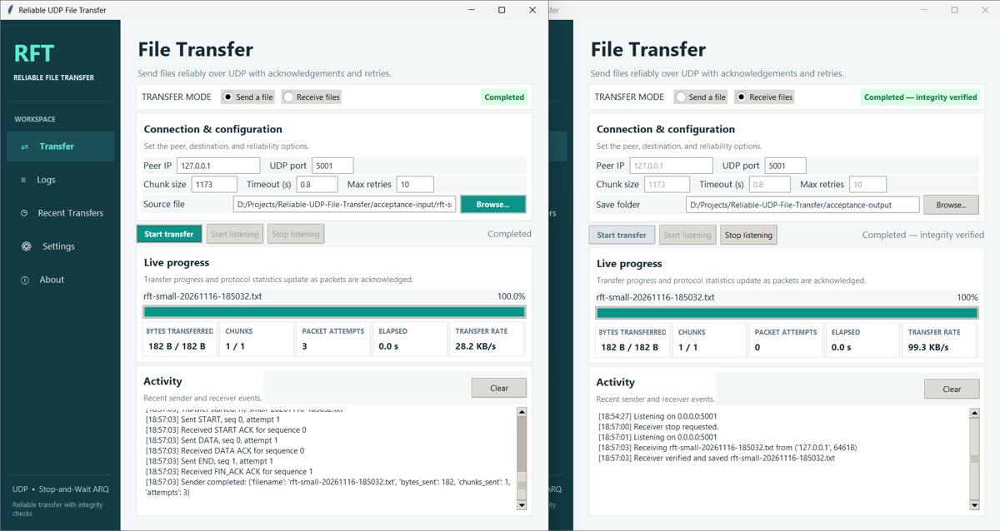
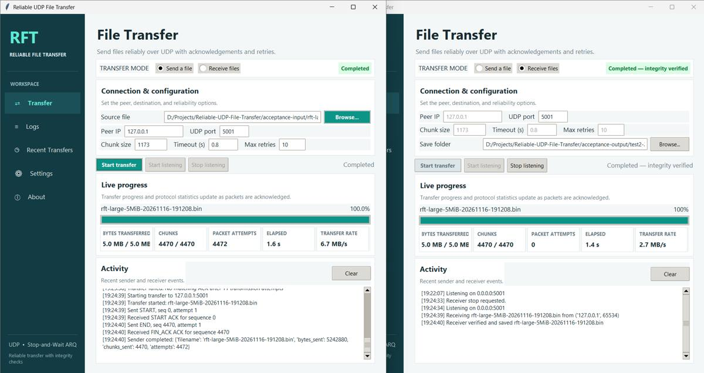
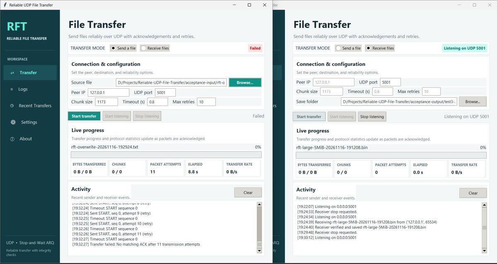
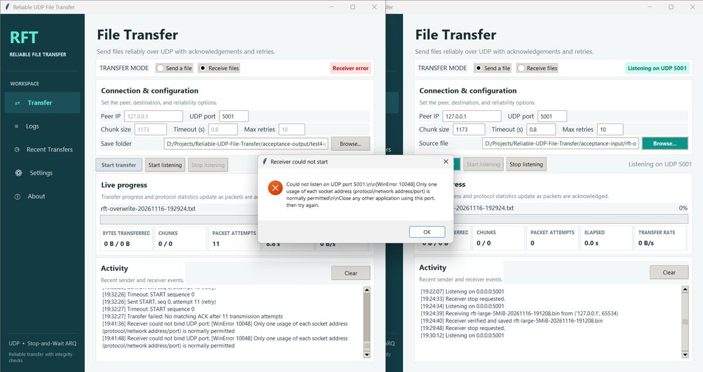
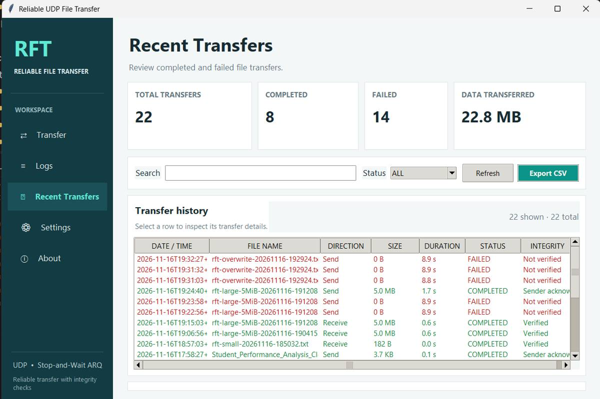

# Manual Acceptance Test Results

**Project:** Reliable UDP File Transfer  
**Environment:** Windows, Python virtual environment, two Tkinter application instances on one laptop; localhost UDP port 5001.  
**Recorded date:** 16 November 2026  
**Automated checks from the same project snapshot:** 107 pytest tests passed; `python -m compileall -q src` passed; `python -m ruff check src tests` reported `All checks passed!`.

This document records observed results. It deliberately distinguishes a proven result from a step that still needs confirmation.

## Summary

| ID | Scenario | Result | Evidence |
|---|---|---|---|
| AT-01 | Small file transfer and SHA-256 | **PASS** | [Screenshot](screenshots/Test-01-Small-File-Transfer.jpg) and PowerShell hash comparison |
| AT-02 | 5 MiB file transfer, 100% progress, and SHA-256 | **PASS** | [Screenshot](screenshots/Test-02-Large-File-Transfer.jpg) and PowerShell size/hash comparison |
| AT-03 | Existing destination is not overwritten | **PASS** | [Screenshot](screenshots/Test-03-Overwrite-Protection.jpg) and PowerShell sentinel/hash check |
| AT-04 | Occupied UDP port error and GUI remains responsive | **PARTIAL** | [Screenshot](screenshots/Test-04-Port-Conflict-Error.jpg); error detected, post-dialog navigation was not separately confirmed |
| AT-05 | Transfer history survives restart and contains successes and failures | **PASS (GUI evidence)** | [Screenshot](screenshots/Test-05-Persistent-History.jpg); after reopening the GUI displayed 22 total, 8 completed, and 14 failed records |

## AT-01 — Small-file transfer and integrity

**Setup:** Generated a 182-byte text file in `acceptance-input`; receiver used a separate folder under `acceptance-output`; sender targeted `127.0.0.1:5001`.

**Observed:**
- Sender status: `Completed`.
- Receiver status: `Completed — integrity verified`.
- Data: 182 B / 182 B; chunks: 1 / 1.
- Activity log showed START ACK, DATA ACK, and FIN_ACK.
- Independent PowerShell SHA-256 comparison printed `PASS: SHA-256 hashes match`.

**Result: PASS.**

## AT-02 — Large-file transfer and integrity

**Setup:** Generated a 5 MiB random binary file (5,242,880 bytes), with a unique destination folder. Chunk size was 1,173 bytes, timeout 0.8 seconds, and max retries 10.

**Observed:**
- Final successful screenshot showed sender `Completed`, receiver `Completed — integrity verified`, and 100% progress.
- Both sides showed 5.0 MB / 5.0 MB and 4,470 / 4,470 chunks.
- PowerShell reported the source and both received copies were 5,242,880 bytes with matching SHA-256 `C8F66007CF4770A0920AF046CE8400826548328DC426D6595F533DDAC2A96C96`.
- An earlier run exposed sender GUI unresponsiveness; the event processing/logging was then bounded and the later screenshot shows both GUIs completed normally.

**Result: PASS for the later successful run.**

## AT-03 — Existing destination file must not be overwritten

**Setup:** Created an incoming file and a pre-existing destination file with the same filename, but different contents. The existing file contained the sentinel text `ORIGINAL FILE - DO NOT OVERWRITE`.

**Observed:**
- Sender ultimately failed to obtain an ACK, which is the current receiver's behaviour when storage rejects the existing destination.
- The receiver continued listening.
- PowerShell verified the destination remained 100 bytes, retained the sentinel text, and its SHA-256 remained different from the incoming source hash.

**Result: PASS for preservation/no-overwrite.** The current user experience is a retry-then-fail on the sender rather than an immediate explicit "file already exists" rejection message; the logs are less friendly than ideal.

## AT-04 — Occupied UDP port and GUI responsiveness

**Setup:** One receiver was listening on UDP port 5001; a second GUI instance attempted to bind the same port.

**Observed:**
- The second instance displayed a `Receiver could not start` dialog with Windows socket error 10048 (the address/port is already in use).
- The Activity log recorded that it could not bind the port.
- The first receiver remained listening.

**Not yet verified:** After dismissing the error dialog, navigating to Logs and back to Transfer was requested but no separate confirmation was received.

**Result: PARTIAL.** The port-conflict detection/message is proven; post-dialog GUI responsiveness still needs a final check.

## AT-05 — Persistent history across restarts

**Setup:** Backed up `%USERPROFILE%\.reliable_udp\transfer_history.json`, closed/reopened the application, then opened Recent Transfers.

**Observed in GUI after restart:**
- Total transfers: 22
- Completed: 8
- Failed: 14
- Both completed and failed records were visible in the table.

**Result: PASS based on GUI persistence evidence.** A PowerShell summary attempt returned inconsistent collection counts compared to the GUI, so those particular PowerShell counts are not used as proof; the screenshot documents the post-restart view.

## Remaining acceptance work

1. Finish AT-04: dismiss the occupied-port dialog, navigate to Logs and Transfer, and confirm the second GUI remains responsive and does not claim to be listening.
2. Re-run a compact JSON count check using Python if the report requires machine-readable counts for AT-05.
3. Test the packaged Windows ZIP on a separate laptop before calling it a verified release.
